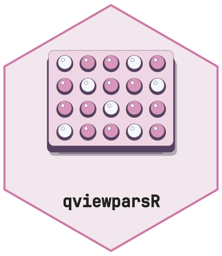
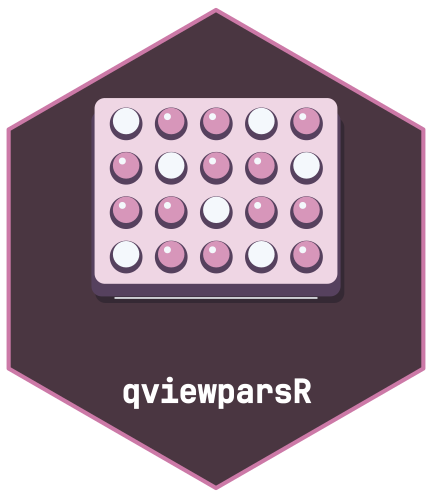

<!-- cttir-vignette-logo: start -->
<style>
.cttir-vignette-logo { float: right; width: 120px; max-width: 30%; margin: 0 0 1rem 1.5rem; }
.cttir-vignette-logo img { width: 100%; height: auto; border: 0; background: transparent; box-shadow: none; }
.cttir-vignette-logo .cttir-vignette-logo-light { display: block; }
.cttir-vignette-logo .cttir-vignette-logo-dark { display: none; }
@media (prefers-color-scheme: dark) {
  .cttir-vignette-logo .cttir-vignette-logo-light { display: none; }
  .cttir-vignette-logo .cttir-vignette-logo-dark { display: block; }
}
[data-bs-theme="light"] .cttir-vignette-logo .cttir-vignette-logo-light { display: block; }
[data-bs-theme="light"] .cttir-vignette-logo .cttir-vignette-logo-dark { display: none; }
[data-bs-theme="dark"] .cttir-vignette-logo .cttir-vignette-logo-light { display: none; }
[data-bs-theme="dark"] .cttir-vignette-logo .cttir-vignette-logo-dark { display: block; }
</style>
<div class="cttir-vignette-logo">
  
  
</div>
<!-- cttir-vignette-logo: end -->

```{r setup, include = FALSE}
knitr::opts_chunk$set(
  collapse = TRUE,
  comment  = "#>",
  eval     = TRUE,
  fig.align = "center",
  fig.width = 7, fig.height = 4.5,
  dpi = 96
)
library(qviewparsR)
```

```{=html}
<style>
:root { --qv-fg:#212121; --qv-bg:#fafafa; --qv-line:#e0e0e0;
        --qv-mute:#666; --qv-card:#fff; --qv-cap:#f0f0f0; }
body  { font-family: system-ui,-apple-system,BlinkMacSystemFont,"Segoe UI",
        Roboto,"Helvetica Neue",Arial,sans-serif;
        color: var(--qv-fg); background: var(--qv-bg);
        line-height: 1.5; max-width: 760px; margin: 2rem auto;
        padding: 0 1.25rem; }
h1, h2, h3, h4 { letter-spacing: .02em; font-weight: 600; }
h1 { font-size: 1.65rem; border-bottom: 1px solid var(--qv-line);
     padding-bottom: .25rem; }
h2 { font-size: 1.25rem; margin-top: 1.6rem; }
h3 { font-size: 1.05rem; margin-top: 1.2rem; color: var(--qv-mute); }
a, a:visited { color: var(--qv-fg); text-underline-offset: .18em; }
a:hover { color: #000; text-decoration-thickness: 2px; }
code, pre, kbd { font-family: "SF Mono",Consolas,"Liberation Mono",Menlo,monospace; }
code { background: var(--qv-card); border: 1px solid var(--qv-line);
       padding: 0 .25rem; border-radius: 3px; }
pre  { background: var(--qv-card); border: 1px solid var(--qv-line);
       padding: .9rem 1rem; border-radius: .25rem; overflow-x: auto; }
pre code { border: 0; padding: 0; background: transparent; }
table { border-collapse: collapse; margin: 0.6rem 0; }
table th { border-bottom: 1px solid var(--qv-fg); text-align: left;
           padding: .35rem .65rem; }
table td { padding: .35rem .65rem; border-bottom: 1px solid var(--qv-line); }
blockquote { border-left: 3px solid var(--qv-fg);
             padding: .25rem .9rem; color: var(--qv-fg);
             background: var(--qv-card); margin: 1rem 0; }
.qv-hero { display:flex; align-items:center; gap:1rem;
           padding-bottom:1rem; border-bottom:1px solid var(--qv-line); }
.qv-hero img { height: 96px; width: auto; }
.qv-hero h1  { border: 0; padding: 0; margin: 0 0 .25rem 0; font-size: 1.6rem; }
.qv-hero p   { margin: 0; color: var(--qv-mute); }
hr { border: 0; border-top: 1px solid var(--qv-line); margin: 1.5rem 0; }
</style>
```

::: qv-hero


::: {.qv-meta}
# qviewparsR
Pure-R parser for `.Q-View` multiplex ELISA project files.
:::

:::

A `.Q-View` file is a single-file binary container that bundles a
plain-text manifest, an embedded H2 SQL database with project
metadata / analyte panel / sample assignments / replicate pixel
intensities (and -- when generated -- a fully rendered CSV report
stored as a CLOB), and one or more LOB segments holding the raw
chemiluminescent plate images.

`qviewparsR` extracts the available embedded report fields as tidy tibbles.
It does not reconstruct database transactions or extract raw images. There is no Java runtime, no H2 database driver, no
compiled code -- all logic is pure R.

## Installation

`qviewparsR` is **pure R** -- no compiled code, no Java runtime, no H2
database driver, and no system libraries -- so it installs identically on
**Windows, macOS, and Linux**. The only hard prerequisite is
**R >= 4.1.0**.

From CRAN:

```r
install.packages("qviewparsR")
```

Development version from GitHub:

```r
if (!requireNamespace("pak", quietly = TRUE)) install.packages("pak")
pak::pak("CTTIR/qviewparsR")
```

Platform notes: on **Windows** no *Rtools* is required (the package
compiles nothing and its CRAN dependencies arrive as binaries); on
**macOS** nothing beyond R is needed; on **Linux** the package itself is
pure R, but a few dependencies (`dplyr`, `readr`, `tidyr`, `openxlsx2`)
contain C++ and build from source unless you use a binary repository
(for example the Posit Public Package Manager or r2u), which avoids
needing a compiler.

The package depends on a small tidyverse-aligned core
(`cli`, `dplyr`, `fs`, `lifecycle`, `openxlsx2`, `readr`, `rlang`, `tibble`,
`tidyr`). Plotting requires `ggplot2`; the publication overview adds
`patchwork`; the Shiny front-end adds `shiny`, `bslib`, `DT`, `withr`.

## A complete walk-through

```{r bundled-project}
library(qviewparsR)

project <- system.file("extdata", "example.Q-View", package = "qviewparsR")
qv <- read_qview(project, verbose = FALSE)
qv                          # one-screen summary

qv$analytes                 # spot_number, analyte, unit, lod, lloq, uloq
qv$well_groups              # one row per sample / calibrator / control
qv$pixel_intensities        # long-format replicate readings
qv$summary_statistics       # per-group mean / std-dev / CV rows
qv$plate_layout             # one row per plate well

summary(qv)                 # mean / SD / CV per well type x analyte
```

`read_qview()` returns the list of class `qview` described in
`?read_qview`. Optional concentrations or curve fits can be `NULL` when
they are absent; check before using them. Reports currently support A1–H12.
Conflicting embedded observations are refused: obtain a fresh producer report
rather than assume the most frequent copy represents the current transaction.

## Reading flat report exports

Sometimes only the flat report Q-View writes next to the binary
container is kept -- the `..._auto_report` or
`..._auto_all-parameters_report` file, as `.csv` or `.xlsx`. When the
original `.Q-View` project is unavailable, `read_qview_report()` parses
that export and returns the same `qview` object `read_qview()` builds:

```{r bundled-report}
report_path <- system.file("extdata", "example-report.csv", package = "qviewparsR")
rep <- read_qview_report(report_path, verbose = FALSE)
is_qview(rep)               # TRUE -- same class as read_qview()
rep$concentrations          # long-format, with an out-of-range `flag`
```

Both readers preserve recognized missing and censored measurements, with
`raw_value` and `flag` alongside the numeric value. A `"< 52.50"` cell
has value 52.50 and flag `<`: it is a bound, not an observed concentration.
`Incalculable` remains missing and flagged. Numeric plots and summary estimates
exclude censored and missing values; summary counts expose both categories.
Malformed nonblank numeric values are errors, not silently missing data.

## The naming convention

The producing software rewrites identifiers from the original
well-assignment template before storing them. The mapping is
systematic and reversible:

| Template value                  | Stored as                          |
|---------------------------------|------------------------------------|
| `Cal 1` ... `Cal N`             | `ICal 1` ... `ICal N`              |
| `Low`                           | `GLow`                             |
| `High`                          | `HHigh`                            |
| `FD24277364`, `1211498458`, ... | `NFD24277364`, `N1211498458`, ...  |

`strip_qview_prefix()` reverses the rewrite. Pass `strip_prefix = TRUE`
to `read_qview()` to apply it across every sample-id column at once:

```{r naming}
qv <- read_qview(project, strip_prefix = TRUE, verbose = FALSE)
unique(qv$well_groups$sample_id)

strip_qview_prefix(c("ICal 1", "GLow", "HHigh", "NFD24277364"))
#> [1] "Cal 1"      "Low"        "High"       "FD24277364"
```

## Coercion and tidy-data idioms

`as_tibble()` returns the long-format `pixel_intensities` table -- the
primary tabular payload -- so a parsed object drops straight into a
dplyr / ggplot2 pipeline:

```{r tidy-analysis}
library(dplyr)

qv |>
  as_tibble() |>
  filter(replicate == 1L, is.na(flag), is.finite(pixel_intensity)) |>
  group_by(analyte, unit) |>
  summarise(median_pi = median(pixel_intensity, na.rm = TRUE),
            .groups = "drop")
```

## Visualisation

The `plot.qview()` method offers three quick-look views. Plate and intensity
maps use viridis palettes; the scatterplot compares replicate pairs:

```{r plots, eval = requireNamespace("ggplot2", quietly = TRUE), fig.alt = c("Synthetic 96-well plate showing standard, negative, sample, control and unassigned wells.", "Replicate-one pixel intensity by well for synthetic Ba and Bb measurements; fill encodes intensity on the shared PI scale.", "Synthetic Ba and Bb replicate-two versus replicate-one pixel intensities, with a dashed identity line in each panel.")}
plot(qv, type = "plate_map")          # 96-well plate, fill = well type
plot(qv, type = "intensity_heatmap")  # facet per analyte, fill = PI
plot(qv, type = "replicate_scatter")  # rep 1 vs rep 2 per analyte
```

Each call returns a `ggplot` object, so themes, scales, and labels can
be added on top:

```{r plot-theme, eval = requireNamespace("ggplot2", quietly = TRUE), fig.alt = "Synthetic plate map with a black-and-white theme, showing the same well assignments as the preceding plate map."}
library(ggplot2)
plot(qv, type = "plate_map") +
  theme_bw(base_size = 12) +
  labs(title = NULL, subtitle = "QC overview")
```

## Exporting

Three writers cover the common destinations. All return the parsed
object invisibly, so they compose with `|>`:

```{r export}
out <- tempfile("qview-vignette-")
dir.create(out)
qv |>
  write_qview_xlsx(file.path(out, "plate.xlsx")) |>
  write_qview_csv(file.path(out, "plate_csv")) |>
  write_qview_rds(file.path(out, "plate.rds"))
stopifnot(identical(readRDS(file.path(out, "plate.rds")), qv))
```

All writers require `overwrite = TRUE` to replace existing output. CSV
replacement is for a dedicated bundle directory and refuses unrelated files.
Keep archival CSV as data: spreadsheet applications may interpret text beginning
with formula characters. Import such columns explicitly as text when viewing them.

The legacy aliases `qview_to_xlsx()` and `qview_to_csv_dir()` still
work but emit `lifecycle::deprecate_warn()`; switch to the new names.

## Cross-validating against a template CSV

Every well assignment is already embedded in the `.Q-View` file. If
you also have the original well-assignment template CSV the producing
application imported, `read_qview_template()` parses it into a tibble
that aligns with `qv$plate_layout`:

```{r template}
tmpl <- read_qview_template(system.file("extdata", "example-template.csv",
                                       package = "qviewparsR"), verbose = FALSE)

qv$plate_layout |>
  dplyr::full_join(tmpl, by = "well", suffix = c("_qview", "_template")) |>
  dplyr::filter(xor(is.na(sample_id_qview), is.na(sample_id_template)) |
                  (!is.na(sample_id_qview) & !is.na(sample_id_template) &
                     sample_id_qview != sample_id_template))
```

Rows surviving the filter expose differing or one-sided missing sample
assignments, including wells present on only one side. The bundled files are
synthetic examples, not independent instrument-validation evidence.

## Interactive front-end

For non-coding collaborators, `qview_app()` launches a Shiny app in
the same monochrome aesthetic (light + dark mode) with the hex sticker
in the upper-left corner:

```r
qview_app()             # 512 MB upload cap by default
qview_app(max_upload_mb = 1024)
```

The app accepts a `.Q-View` upload (and optionally a template CSV) and
exposes:

* a publication-ready 2x2 **Overview** figure (plate layout / pixel
  intensity distribution / replicate concordance / mean PI by well
  type) with high-DPI PNG and vector PDF export;
* every parsed table with its own xlsx download;
* one-click **xlsx / rds / csv-zip** of the whole project;
* a built-in dark/light toggle and per-card max/restore.

Changing uploads or parsing settings clears previous results; parse again
before exporting. The downloaded metadata retains original upload names and
settings. PNG dimensions must be 3–30 inches, DPI 72–1200, and the product of
width, height and squared DPI must not exceed 50 million pixels. PDF exports
remain vector graphics. Invalid settings produce an error rather than a
silently resized figure.

## Error handling

Every exported function validates inputs early and raises a structured
`cli::cli_abort()` error pointing at the user's call rather than at
internal helpers, e.g.:

```
Error in `read_qview()`:
! `path` must be an existing file.
x "missing.Q-View" does not exist.
```

```
Error in `read_qview()`:
! `path` is not a valid `.Q-View` project file.
x "junk.bin" is missing the expected container header.
i Expected a numeric container version followed by "Q-View Project".
```

The `i` bullet always carries an actionable hint when one exists.

## Citation

```r
citation("qviewparsR")
```

BibTeX:

```bibtex
@Manual{qviewparsR,
  title  = {qviewparsR: Read .Q-View Multiplex ELISA Project Files},
  author = {R. Heller and M. Mannes},
  year   = {2026},
  note   = {R package version 1.1.0},
  doi    = {10.32614/CRAN.package.qviewparsR},
  url    = {https://CRAN.R-project.org/package=qviewparsR},
}
```

To cite a specific archived source snapshot instead, use the Zenodo
software DOI:

```bibtex
@software{heller_2026_21395352,
  author    = {Heller, Raban and Mannes, Marco},
  title     = {qviewparsR - Read .Q-View Multiplex ELISA Project Files},
  month     = jul,
  year      = 2026,
  publisher = {Zenodo},
  version   = {1.0.0},
  doi       = {10.5281/zenodo.21395352},
  url       = {https://doi.org/10.5281/zenodo.21395352},
}
```
